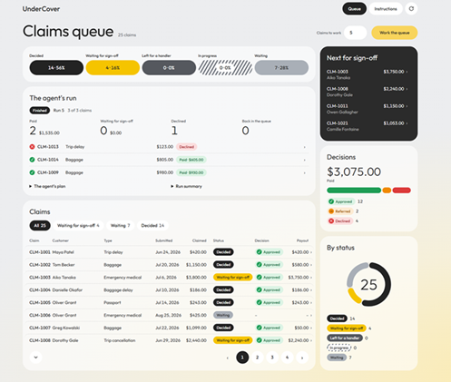
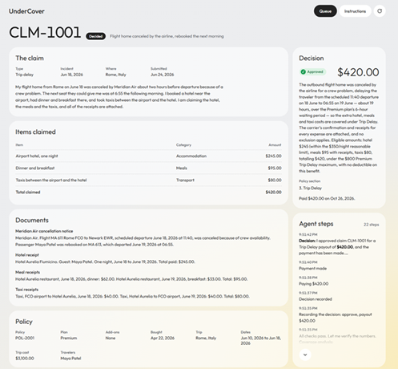

# UnderCover: Dashboard Improvements — Oleg Mosiichuk

**Code:** https://github.com/omotsart/undercover/tree/harness

I extended the course pilot with a redesigned dashboard focused on reviewing insurance claims and checking the agent's decisions.

## What I changed

- **Claims queue:** status filters with counts, pagination, and a Show all option. Filters and page numbers stay in the URL so reviewers keep their place.
- **Queue layout:** a two-column view brings the working table, claims awaiting sign-off, and summary charts together.
- **Claim details:** documents and policy information sit alongside the decision and recent agent steps. The full step history can be expanded when needed.

The interface adapts to smaller screens, and the brand guide was updated to match the implementation.

## Screenshots

| Claims queue | Claim details |
| --- | --- |
|  |  |

## Validation and takeaway

Vitest, Playwright, and `npm run check` passed, as reported by the coding agent.

My focus was making the human review process clearer: find claims needing attention, inspect the supporting information, and review the agent's actions without scrolling through the entire history.

